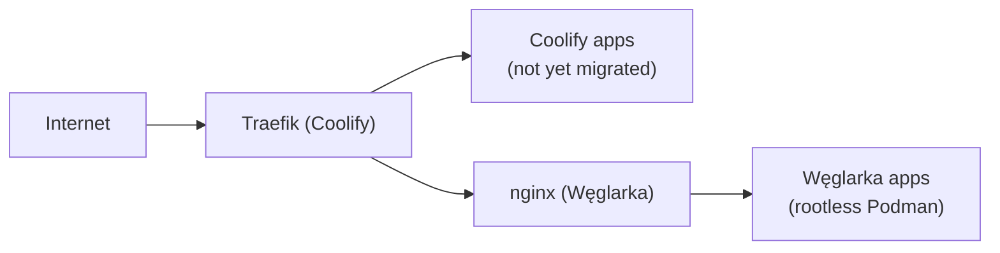
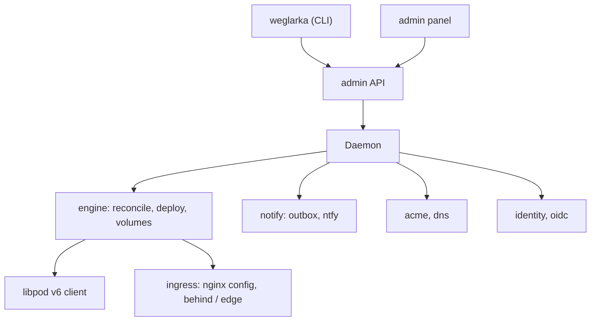

# Węglarka

[](https://jpalczewski.github.io/weglarka/)

A self-hosted deploy platform for a single small host, written in Rust and built on **rootless Podman**.
Think Coolify, but declarative (TOML instead of a database), without Docker, without PHP, with a small memory
footprint. You can run it **next to Coolify and move apps over one at a time**.

Priorities, in this order: **security → extensible code → low RAM.**

Status: the daemon, CLI, read-mostly admin panel, ingress, ACME, identity provider and self-update are in use.
Work in progress is tracked as [roadmap issues](https://github.com/jpalczewski/weglarka/issues?q=label%3Aroadmap)
and in the [roadmap project](https://github.com/users/jpalczewski/projects/12) (see [Roadmap](#roadmap)).

## Why

- **Designed for Alpine.** The target host is a small Alpine VPS: static musl binaries, no dependency on systemd in
  the design, tiny images. It does not run on Alpine yet: the install guide covers Ubuntu with systemd today, and
  OpenRC support is in progress ([#46](https://github.com/jpalczewski/weglarka/issues/46)).
- **Rootless.** Everything runs as an unprivileged user through the libpod API (v6) on a unix socket. Containers are
  hardened by default and the ingress container is always hardened.
- **Declarative.** `apps.toml` is the desired state; a reconcile loop makes the host match it. State files are
  versioned and can be rolled back across schema versions.
- **Small.** One daemon, one CLI, an nginx container for ingress. No database server, no queue.
- **Migrate, don't big-bang.** In `behind` mode Węglarka's nginx sits behind the Traefik that Coolify already runs.
  Move an app, check it, roll back if needed, repeat. When you are done, switch to `edge` and drop Coolify.

## Migrating from Coolify



1. Install Węglarka on the same host in `behind` mode. Traefik keeps terminating TLS; a root-owned path unit with a
   validator publishes only allowlisted domains to Traefik, so Węglarka never gets access to Coolify's directory.
2. Add an app without its domain, import its data, and let it pass the health gate while Coolify keeps serving.
3. Stop the old container in Coolify and attach the domain to the Węglarka app (an nginx reload, no redeploy).
4. If anything is wrong, remove the app and start the old container again.
5. When the last app has moved, switch to [`edge` mode](docs/guides/edge-mode.md): nginx on 80/443 with its own
   [ACME](docs/guides/acme.md) certificates, no Traefik.

Step by step: [switching an app over from Coolify](docs/guides/first-app.md)
and [importing data](docs/guides/data-import.md). What stays in Coolify for now: its UI for creating applications and
its builds from a repository. Węglarka deploys images from a registry (or a local archive with `weglarka push`).

## A taste

```toml
# apps.toml
[apps.db]
image   = "ghcr.io/example/postgres:16"
volumes = [{ name = "data", target = "/var/lib/postgresql/data" }]
health  = { command = ["pg_isready", "-U", "postgres"] }

[apps.api]
image      = "ghcr.io/example/api:latest"
domains    = ["api.example.com"]
port       = 8080
depends_on = ["db"]
```

```sh
weglarka apps add api ghcr.io/example/api:latest --domain api.example.com --port 8080 --depends-on db
weglarka status             # pull, health gate, switch traffic: the deploy starts by itself
```

Full examples to copy: [`docs/examples/`](docs/examples/). Your first app: [docs/guides/first-app.md](docs/guides/first-app.md).

## Features

Every line links to a guide; the full index is in [`docs/guides/`](docs/guides/README.md).

**Deploying**
- Reconcile from TOML; auto-update on a GitHub or Forgejo webhook ([webhooks](docs/guides/webhooks.md)).
- Health gate with automatic rollback ([verify and rollback](docs/guides/verify-and-rollback.md)),
  [blue-green deploys](docs/guides/blue-green.md) for stateless apps, [`depends_on`](docs/guides/dependencies.md).
- Deploy a local image with [`weglarka push`](docs/guides/push-local-images.md); run [one-off commands](docs/guides/one-off-commands.md)
  and [forward ports](docs/guides/port-forward.md) from your laptop.
- [Static sites](docs/guides/static-sites.md) with development and production [environments](docs/guides/site-environments.md).

**Ingress and TLS**
- nginx in a container, in `behind` or [`edge`](docs/guides/edge-mode.md) mode; [path routing](docs/guides/path-routing.md),
  [streaming](docs/guides/streaming.md), [non-HTTP host ports](docs/guides/host-ports.md).
- Built-in [ACME](docs/guides/acme.md) (HTTP-01, DNS-01 [wildcards](docs/guides/wildcard-certificates.md)),
  also [behind a CDN](docs/guides/edge-cdn.md).

**Identity and access**
- [Forward auth](docs/guides/forward-auth.md) in front of any app, with Authelia run as a managed app and OIDC clients
  per app ([identity provider](docs/guides/identity-provider.md)).
- A read-mostly [admin panel](docs/guides/admin-panel.md) (OIDC login), [scoped API tokens](docs/guides/admin-api-tokens.md)
  and [`weglarka login`](docs/guides/remote-cli.md) with the device flow.
- A CLI that is safe to hand to a coding agent ([operating with the CLI](docs/guides/agent-cli.md)).

**Data and secrets**
- Volumes with per-app UID ranges, [shared volumes](docs/guides/shared-volumes.md) (including SQLite with several
  writers), [import and export](docs/guides/data-import.md); [secrets](docs/guides/first-app.md) that never reach logs
  or TOML, and [host config files](docs/guides/host-configs.md).

**Operations**
- ntfy [notifications](docs/guides/notifications.md) through a durable outbox, [crash detection](docs/guides/crash-detection.md),
  opt-in Prometheus [metrics](docs/guides/metrics.md), `doctor` checks.
- Signed [self-update](docs/guides/self-update.md) with a watchdog and automatic fallback.

## Roadmap

In progress or planned, all tracked as issues:

- OpenRC platform for Alpine hosts ([#46](https://github.com/jpalczewski/weglarka/issues/46)).
- Managed databases and other host-level platform services ([#81](https://github.com/jpalczewski/weglarka/issues/81)).
- Panel actions: today the panel only shows state, writes come later, each with its own review.
- Encrypted secret store with `age` ([#51](https://github.com/jpalczewski/weglarka/issues/51)).
- PR preview instances ([#105](https://github.com/jpalczewski/weglarka/issues/105)), Loki log shipping
  ([#82](https://github.com/jpalczewski/weglarka/issues/82)), an Ansible collection ([#179](https://github.com/jpalczewski/weglarka/issues/179)).

## Installation

The `ghcr.io/jpalczewski/weglarka` image (a rootless Podman container) plus the `weglarka` CLI from GitHub Release
assets: host requirements, `weglarka.toml`, startup, the CLI over an SSH tunnel, the first app, the GitHub webhook,
signature verification and rollback — [docs/install.md](docs/install.md), then the topic [guides](docs/guides/README.md).

## Architecture



`weglarka-model` (domain model, state files, traits) · `weglarka-engine` · `weglarka-podman` · `weglarka-ingress` ·
`weglarka-notify` · `weglarka-acme` / `weglarka-dns` · `weglarka-identity` / `weglarka-oidc` · `weglarka-registry` ·
`weglarka-api` (admin API contract) · `weglarka-http` / `weglarka-unix-http` · `weglarka-panel` ·
`weglarka-daemon` · `weglarka-cli` (the `weglarka` binary). Implementation decisions and the rejected alternatives:
[docs/decisions](docs/decisions/README.md).

## Contributing

```sh
cargo fmt --check && cargo clippy --workspace --all-targets -- -D warnings && cargo test --workspace
```

Conventions and division of work: [CLAUDE.md](CLAUDE.md). Parallel agent sessions, issues and the roadmap project:
[agent workflow](docs/contributing/agent-workflow.md), [issues and project](docs/contributing/issues-and-project.md).

## License

`MIT OR Apache-2.0` — [LICENSE-MIT](LICENSE-MIT), [LICENSE-APACHE](LICENSE-APACHE).
